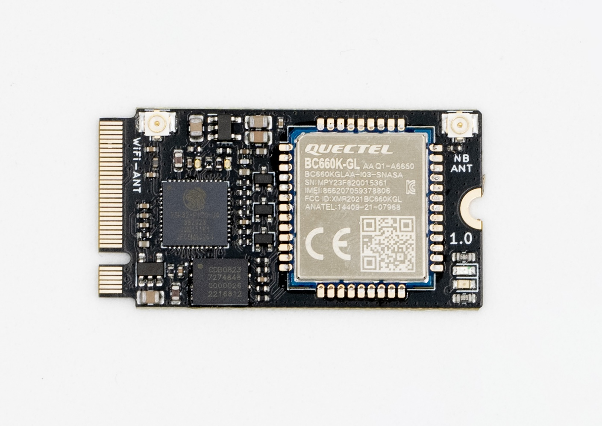

# Thinger M2 IoT Modem

The Thinger M2IoT Modem is a compact M.2-format connectivity module that combines an Espressif ESP32-PICO-D4 with a Quectel BC660K-GL NB-IoT modem and a pre-installed 1NCE eSIM, providing Wi-Fi, Bluetooth and NB-IoT in a 22 × 42 mm board.

<figure><figcaption></figcaption></figure>


The M2IoT uses the **M.2 2242 mechanical format only**. Its pinout is **not compatible with standard M.2 slots** (for example, the ones found on laptops or SSD adapters). Use it only with carrier boards designed for this module.&#x20;


Designed by the Thinger.io team, this module is aimed at developers, makers and industry professionals who need to add **Wi-Fi, Bluetooth and cellular NB-IoT connectivity** to their own hardware with minimal integration effort and the best compatibility with the Thinger.io platform. The ESP32 handles the application and the Wi-Fi/Bluetooth connectivity, and controls the Quectel modem through a UART and a few control lines, so the whole module can be programmed from a single processor using the Arduino Framework, ESP-IDF or MicroPython.

* The **BC660K-GL** is a high-performance LTE Cat NB2 module with extremely low power consumption, supporting the frequency bands B1/2/3/4/5/8/12/13/17/18/19/20/25/28/66/70/85. It is controlled through AT commands.
* The **ESP32-PICO-D4** is a System-in-Package with a dual-core Xtensa® LX6 microprocessor, Wi-Fi and Bluetooth, and integrates a 4 MB SPI flash and a 40 MHz crystal oscillator, so it requires very few external components.
* The module includes a soldered **1NCE eSIM (MFF2)**, so no SIM card or SIM holder is needed to connect to the NB-IoT network.
* Two **U.FL connectors** are available to attach independent antennas for Wi-Fi/Bluetooth and for NB-IoT.

### Technical Specifications

| Feature               | Specification                                                                               |
| --------------------- | ------------------------------------------------------------------------------------------- |
| Form factor           | M.2 2242 (22 × 42 mm), 4-layer PCB                                                          |
| Processor             | ESP32-PICO-D4, Xtensa® dual-core 32-bit LX6 up to 240 MHz                                   |
| Memory                | 4 MB SPI flash, 520 KB SRAM, 448 KB ROM, 16 KB RTC SRAM                                     |
| WiFi                  | 802.11 b/g/n, 2.4 GHz, up to 150 Mbps                                                       |
| Bluetooth             | Bluetooth v4.2 BR/EDR and BLE                                                               |
| NB-IoT modem          | Quectel BC660K-GL (LTE Cat NB2)                                                             |
| NB-IoT bands          | B1/2/3/4/5/8/12/13/17/18/19/20/25/28/66/70/85                                               |
| SIM                   | 1NCE eSIM (MFF2), soldered on board                                                         |
| Antenna connectors    | 2 × U.FL: WiFi-ANT (Wi-Fi / Bluetooth) and NB ANT (NB-IoT)                                  |
| GPIO                  | 10 configurable ESP32 GPIOs available at the connector (plus UART0 and GPIO0)               |
| Programming           | Arduino Framework, ESP-IDF, MicroPython, through the UART0 of the ESP32                     |
| LEDs                  | NB-IoT modem power, NB-IoT network status, ESP32 UART TX, user LED                          |
| Supported peripherals | UART, SPI, I2C, I2S, LED PWM, pulse counter, GPIO, capacitive touch sensor, ADC, DAC, TWAI® |

#### Electrical Characteristics

| Power source                                | Voltage | Current |
| ------------------------------------------- | ------- | ------- |
| VBUS (connector pins 1 and 2)               | 5 V     | TBD     |
| 3.3 V output (connector pins 38, 49 and 54) | 3.3 V   | TBD     |

The 3.3 V pins are connected to the ESP32 supply rail and can be used as a reference or to power low-consumption external circuits. The supply of the NB-IoT modem is generated internally and is not available at the connector.&#x20;

### Hardware overview

| Element           | Description                                                                                                  |
| ----------------- | ------------------------------------------------------------------------------------------------------------ |
| ESP32-PICO-D4     | Main processor with Wi-Fi, Bluetooth and 4 MB of flash. It runs the user application and controls the modem. |
| Quectel BC660K-GL | NB-IoT modem, connected to the ESP32 through a UART and three control lines.                                 |
| 1NCE eSIM         | Soldered MFF2 eSIM connected to the BC660K-GL.                                                               |
| WiFi-ANT (U.FL)   | Antenna connector for Wi-Fi and Bluetooth.                                                                   |
| NB ANT (U.FL)     | Antenna connector for NB-IoT.                                                                                |

#### LEDs

<figure><figcaption></figcaption></figure>

| LED                            | Indicates                                                | Behavior                                                                                 |
| ------------------------------ | -------------------------------------------------------- | ---------------------------------------------------------------------------------------- |
| LED1 - Modem power - RED       | The Quectel BC660K-GL is powered on.                     | On while the modem is on.                                                                |
| LED2 - Network status - YELLOW | NB-IoT connection status (NETLIGHT output of the modem). | Driven by the modem. The blinking pattern depends on the modem LED mode (`AT+QLEDMODE`). |
| LED3 - TX - BLUE               | ESP32 UART0 transmission.                                | Blinks when the ESP32 sends data through UART0 (programming or serial console).          |
| LED4 - User - RED              | Free for the user application.                           | Connected to GPIO21. Set GPIO21 to HIGH to turn it on.                                   |

### Pinout

<figure><figcaption></figcaption></figure>

The following table shows the connections available at the M.2 edge connector. Pins that are not listed are not connected.

| M.2 pin                       | Signal          | ESP32 GPIO | Notes                                                                                 |
| ----------------------------- | --------------- | ---------- | ------------------------------------------------------------------------------------- |
| 1, 2                          | VBUS            |            | Power input (5 V)                                                                     |
| 3, 25, 40, 47, 56, 63, 65, 67 | GND             |            | Ground                                                                                |
| 4                             | TXD0            | GPIO1      | UART0 TX. Console and programming.                                                    |
| 6                             | RXD0            | GPIO3      | UART0 RX. Console and programming.                                                    |
| 8                             | IO0             | GPIO0      | Boot mode selection. Keep LOW at reset to enter the flash download mode.              |
| 10                            | RESET           | EN         | ESP32 reset (active LOW).                                                             |
| 20                            | TxBC-RxESP      | GPIO4      | Connected to the TXD output of the modem (ESP32 RX). Also available at the connector. |
| 22                            | RxBC-TxESP      | GPIO13     | Connected to the RXD input of the modem (ESP32 TX). Also available at the connector.  |
| 24                            | IO12            | GPIO12     | ADC2, touch. Strapping pin: do not drive it HIGH at boot.                             |
| 26                            | IO14            | GPIO14     | ADC2, touch                                                                           |
| 28                            | IO27            | GPIO27     | ADC2, touch                                                                           |
| 30                            | IO26            | GPIO26     | ADC2, DAC2                                                                            |
| 32                            | IO25            | GPIO25     | ADC2, DAC1                                                                            |
| 34                            | IO32            | GPIO32     | ADC1, touch                                                                           |
| 36                            | IO33            | GPIO33     | ADC1, touch                                                                           |
| 38, 49, 54                    | +3.3V           |            | 3.3 V output                                                                          |
| 42                            | IO19            | GPIO19     |                                                                                       |
| 44                            | IO21            | GPIO21     | Shared with the user LED.                                                             |
| 46                            | IO22            | GPIO22     |                                                                                       |
| 48                            | PWRKEY          | GPIO23     | Controls the power key of the modem.                                                  |
| 50                            | PSM\_EINT       | GPIO5      | Controls the PSM\_EINT input of the modem.                                            |
| 52                            | RESET\_BC       | GPIO18     | Resets the modem.                                                                     |
| 66                            | BC\_EXT\_ENABLE |            | BC660 external power control                                                          |
| 68                            | SIM\_IO\_EXT    |            | SIM IO external pin                                                                   |
| 70                            | SIM\_RST\_EXT   |            | SIM RST external pin                                                                  |
| 72                            | SIM\_CLK\_EXT   |            | SIM CLK external pin                                                                  |
| 74                            | SIM\_VDD        |            | SIM VDD                                                                               |


GPIO4, GPIO13, GPIO23, GPIO5 and GPIO18 are used internally to communicate with and control the NB-IoT modem. **Do not drive them from external hardware** if the modem is in use.



The SIM lines (pins 68, 70, 72 and 74) are connected to the on-board eSIM. Do not connect an additional SIM card to these lines.&#x20;


#### Internal connections to the NB-IoT modem

| Function      | ESP32 GPIO | Description                                                                    |
| ------------- | ---------- | ------------------------------------------------------------------------------ |
| Modem UART RX | GPIO4      | Receives data from the modem TXD pin.                                          |
| Modem UART TX | GPIO13     | Sends data to the modem RXD pin.                                               |
| PWRKEY        | GPIO23     | HIGH level pulls the modem PWRKEY pin LOW (power on / power off).              |
| RESET         | GPIO18     | HIGH level pulls the modem RESET pin LOW (hardware reset).                     |
| PSM\_EINT     | GPIO5      | HIGH level pulls the modem PSM\_EINT pin LOW (wake up from power saving mode). |

The three control lines are inverted: a HIGH level in the GPIO activates the corresponding modem input. The default UART speed to communicate with the modem is 115200 baud.

### Getting Started

**1. Install the Required Software**

* **Arduino IDE** (with the ESP32 board manager) or **Visual Studio Code** with the **PlatformIO** extension.
* Install the Thinger.io library and the TinyGSM library in the project.

**2. Connect the Module**

* Attach the antennas to the **WiFi-ANT** and **NB ANT** U.FL connectors.
* Insert the module in a compatible carrier board and power it through VBUS.
* The module does not include a USB interface. Connect a USB-UART adapter to the UART0 pins (TXD0, RXD0) of the carrier board.

**3. Upload the First Sketch**

* To enter the flash download mode, hold GPIO0 LOW while resetting the ESP32 (RESET pin), and then upload the sketch.
* Select the **ESP32 Dev Module** board in the Arduino IDE.
* Use the Thinger.io libraries to configure the **Wi-Fi or NB-IoT** connectivity in a few lines of code.

### Example code

This example shows how to connect to the Thinger.io platform through the NB-IoT modem using the TinyGSM and Thinger.io libraries. To work with the Wi-Fi or Bluetooth modems, just use the common ESP32 source code.

The module comes with a 1NCE eSIM, so the APN to use is `iot.1nce.net` (no user or password).

```cpp
#define THINGER_SERVER "acme.thinger.io"
#define THINGER_SERIAL_DEBUG
#define _DISABLE_TLS_
#include <Arduino.h>

// Serial for the debug console and serial for the modem
#define SerialMon Serial
#define SerialAT  Serial1

// Select the modem
#define TINY_GSM_MODEM_BC660
#define TINY_GSM_DEBUG SerialMon
#ifndef TINY_GSM_RX_BUFFER
#define TINY_GSM_RX_BUFFER 1024
#endif

#include <TinyGsmClient.h>
#include <ThingerTinyGSM.h>
#include "arduino_secrets.h"   // USERNAME, DEVICE_ID, DEVICE_CREDENTIAL

// M2IoT modem pins
#define PIN_MODEM_RX      4    // ESP32 RX <- modem TXD
#define PIN_MODEM_TX      13   // ESP32 TX -> modem RXD
#define PIN_MODEM_PWR_KEY 23
#define PIN_MODEM_RESET   18
#define PIN_MODEM_PSM     5
#define PIN_USER_LED      21

// 1NCE APN
#define APN_NAME  "iot.1nce.net"
#define APN_USER  ""
#define APN_PSWD  ""

ThingerTinyGSM thing(USERNAME, DEVICE_ID, DEVICE_CREDENTIAL, SerialAT);

void setup() {
  pinMode(PIN_MODEM_PWR_KEY, OUTPUT);
  pinMode(PIN_MODEM_RESET,   OUTPUT);
  pinMode(PIN_MODEM_PSM,     OUTPUT);
  pinMode(PIN_USER_LED,      OUTPUT);

  Serial.begin(115200);
  SerialAT.begin(115200, SERIAL_8N1, PIN_MODEM_RX, PIN_MODEM_TX);
  delay(400);

  // set the APN
  thing.setAPN(APN_NAME, APN_USER, APN_PSWD);

  // hardware reset of the modem (a HIGH level activates the reset line)
  thing.setModuleReset([]{
    digitalWrite(PIN_MODEM_RESET, HIGH);
    delay(100);
    digitalWrite(PIN_MODEM_RESET, LOW);
  });

  thing.initModem([](TinyGsm& modem){
    // disable power saving mode and eDRX
    modem.sendAT("+CPSMS=0");
    modem.waitResponse();
    modem.sendAT("+CEDRXS=0");
    modem.waitResponse();

    // enable the network status LED
    modem.sendAT("+QLEDMODE=1");
    modem.waitResponse();
  });

  // user LED controlled from the platform
  thing["led"] << digitalPin(PIN_USER_LED);

  // modem information
  thing["modem"] >> [](pson& out){
    out["modem"]    = thing.getTinyGsm().getModemInfo().c_str();
    out["IMEI"]     = thing.getTinyGsm().getIMEI().c_str();
    out["CCID"]     = thing.getTinyGsm().getSimCCID().c_str();
    out["operator"] = thing.getTinyGsm().getOperator().c_str();
  };
}

void loop() {
  thing.handle();
}
```


If the modem does not power on automatically, generate a pulse on the PWRKEY line (GPIO23) before starting the connection. The timings required by the modem are described in the Quectel BC660K-GL hardware design document. \{% endhint %\}


### Design files


#### Related documents

* [Quectel BC660K-GL product page](https://www.quectel.com/product/lpwa-bc660k-gl/)
* [ESP32-PICO-D4 datasheet](https://www.espressif.com/sites/default/files/documentation/esp32-pico-d4_datasheet_en.pdf)
* [1NCE IoT Connectivity](https://1nce.com/)

### Use Cases

🔹 **Smart Cities & Remote Monitoring** – Low-power sensors with NB-IoT for real-time monitoring\
🔹 **Industrial IoT (IIoT)** – Secure cloud connectivity for machinery and logistics tracking\
🔹 **Asset tracking & Logistics** – Connectivity in locations without Wi-Fi coverage\
🔹 **Home Automation** – Wi-Fi and cellular connectivity for smart devices\
🔹 **Agriculture & Environment** – Remote sensing with ultra-low power requirements

### Additional considerations

* This module is not designed for use in standard M.2 slots. Connecting it to a computer or a standard M.2 socket may damage the module and the host.
* NB-IoT coverage and available bands depend on the country and the network operator. Check the coverage of the 1NCE network in the deployment location.
* An antenna must be connected to the NB ANT connector whenever the modem is in use.

**Disclaimer**

This device is commercialized by INTERNET OF THINGER S.L. (Thinger.io platform) as a self-certified development kit. Consequently, it is not subject to common commercial homologation rules. The device owner is liable for all injuries to third parties and damage to their properties.
